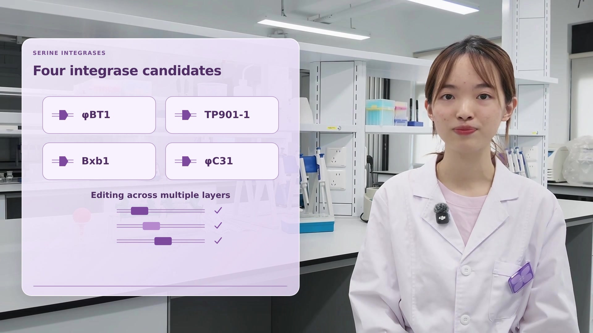
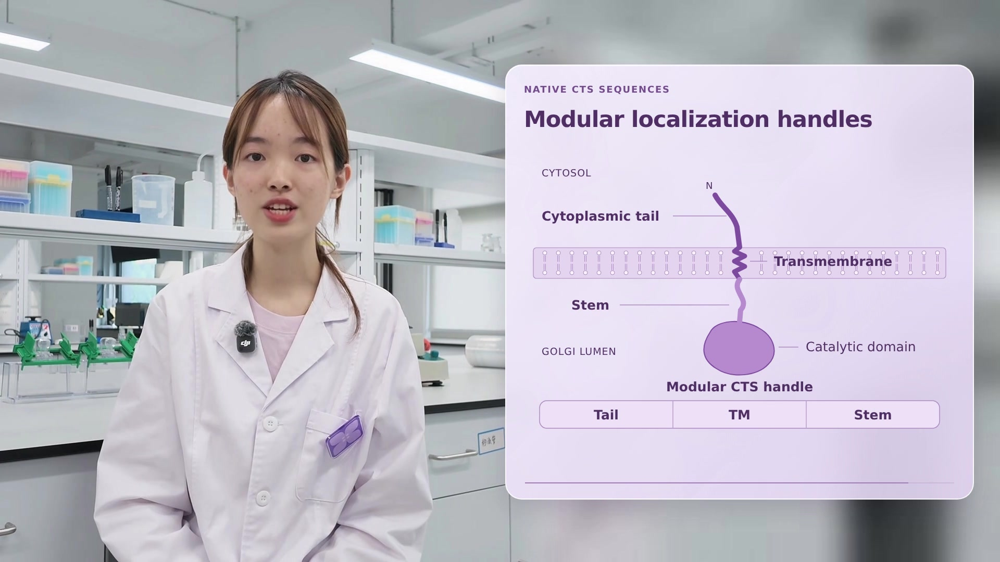

# 紫色玻璃讲解视频

## 第四段：整合酶与 DNA 状态写入（左侧面板）

[下载第四段视频 MP4](https://github.com/Wang-Ke-Yi/-/raw/refs/heads/main/purple-glass-talk/integrase-state-writers.mp4) · [下载第四段 HyperFrames 工程](https://github.com/Wang-Ke-Yi/-/raw/refs/heads/main/purple-glass-talk/integrase-state-writers-project.zip)

28 秒。本段直接使用原片左侧预留空间放置紫色玻璃面板，保留完整构图、人物位置和清晰实验室背景，不做背景虚化、镜像延展、背景复制或面板 backdrop blur。保留原声，不加口播字幕或配乐。先展示组合 DNA 状态，再展示 attB/attP 交换生成 attL/attR 新连接位点与稳定状态，最后依次介绍 φBT1、TP901-1、Bxb1、φC31 四种候选和多层级编辑的概念。图解不指定具体 DNA 序列、靶点配对或已测得的正交性。

## 第三段：高尔基体定位与 CTS 模块

[下载第三段视频 MP4](https://github.com/Wang-Ke-Yi/-/raw/refs/heads/main/purple-glass-talk/golgi-localization.mp4) · [下载第三段 HyperFrames 工程](https://github.com/Wang-Ke-Yi/-/raw/refs/heads/main/purple-glass-talk/golgi-localization-project.zip)

16.5 秒。先展示高尔基体内的定位，再展示胞质尾、跨膜区、stem 与腔内催化结构域的示意，最后汇总为 CTS 定位模块。保留原声，不加口播字幕或配乐。背景恢复为与前两段一致的柔和处理和紫色玻璃面板，取消镜像延展；人物保持清晰。

## 第二段：启动子工程

[下载第二段视频 MP4](https://github.com/Wang-Ke-Yi/-/raw/refs/heads/main/purple-glass-talk/promoter-engineering.mp4) · [下载第二段 HyperFrames 工程](https://github.com/Wang-Ke-Yi/-/raw/refs/heads/main/purple-glass-talk/promoter-engineering-project.zip)

9.3 秒，沿用同一紫色玻璃面板、人物位置与字体。先把复杂性转化为设计机会，再依次展示启动子调节、酶丰度和催化能力。保留原始 AAC 音轨，不加口播字幕或配乐。图解为定性示意，不含测量数据。

## 第一段：糖链多样性

[下载视频 MP4](https://github.com/Wang-Ke-Yi/-/raw/refs/heads/main/purple-glass-talk/purple-glass-no-subtitles.mp4?v=side-panel) · [下载 HyperFrames 工程](https://github.com/Wang-Ke-Yi/-/raw/refs/heads/main/purple-glass-talk/hyperframes-project.zip?v=side-panel)

根据用户参考截图重做布局：左侧人物讲解，右侧紫色半透明圆角玻璃面板，展示糖链多样性以及酶活性、定位、底物可用性、反应顺序四个影响因素。图解按讲解分步出现。

保留原片 13.2 秒完整讲解和原始 AAC 音轨。不加口播字幕；面板内保留图解标题和关键词，不加配乐。本次更新替换此前的视频外围边框版本，文件名和目录保持不变。

输出为 1920×1080、30 fps、H.264/AAC MP4。如 GitHub 不直接播放，请点击上方链接下载后观看。

画面和动画由 HyperFrames 0.8.181 渲染，最终用 FFmpeg 复制原始音轨。工程包包含可编辑生成器、HTML、用户提供的讲解原文、素材、字体、GSAP 和重新导出脚本。糖链图形为概念示意，不代表特定单糖序列。
