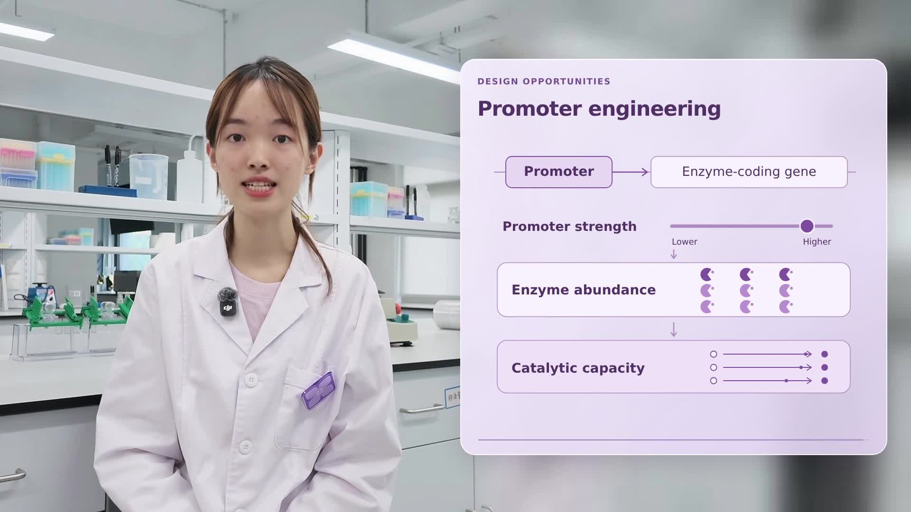
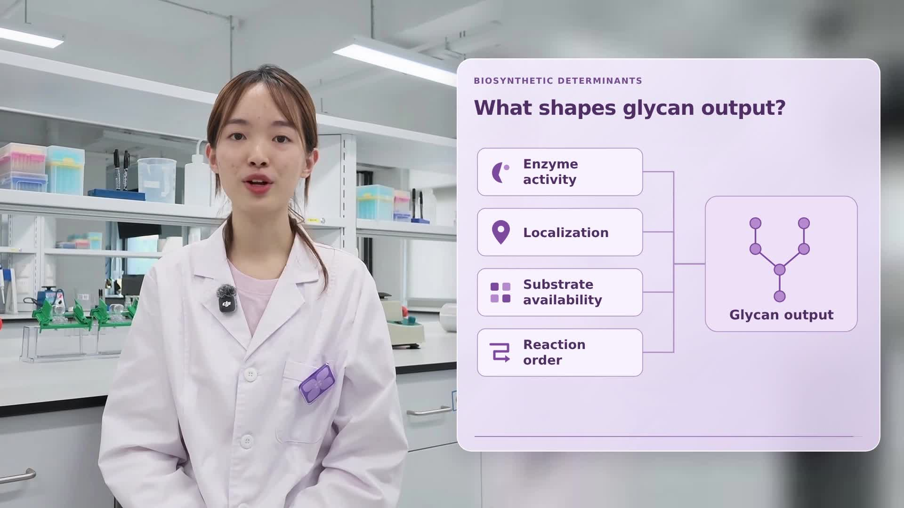
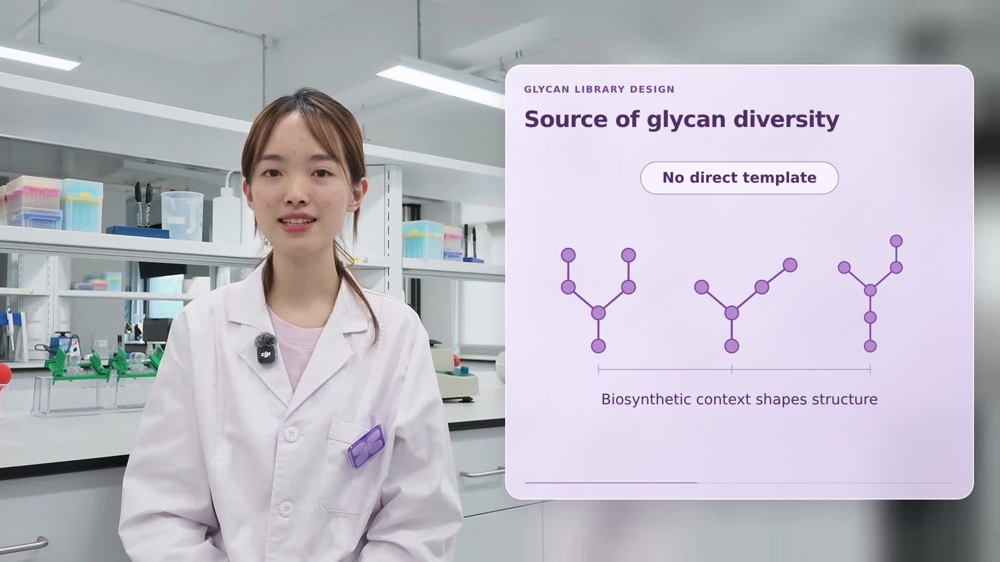

# 左侧人物＋右侧紫色玻璃讲解面板

## 第二段：启动子工程

[下载第二段视频 MP4](https://github.com/Wang-Ke-Yi/-/raw/refs/heads/main/purple-glass-talk/promoter-engineering.mp4) · [下载第二段 HyperFrames 工程](https://github.com/Wang-Ke-Yi/-/raw/refs/heads/main/purple-glass-talk/promoter-engineering-project.zip)

9.3 秒，沿用同一紫色玻璃面板、人物位置与字体。先把复杂性转化为设计机会，再依次展示启动子调节、酶丰度和催化能力。保留原始 AAC 音轨，不加口播字幕或配乐。图解为定性示意，不含测量数据。

## 第一段：糖链多样性

[下载视频 MP4](https://github.com/Wang-Ke-Yi/-/raw/refs/heads/main/purple-glass-talk/purple-glass-no-subtitles.mp4?v=side-panel) · [下载 HyperFrames 工程](https://github.com/Wang-Ke-Yi/-/raw/refs/heads/main/purple-glass-talk/hyperframes-project.zip?v=side-panel)

根据用户参考截图重做布局：左侧人物讲解，右侧紫色半透明圆角玻璃面板，展示糖链多样性以及酶活性、定位、底物可用性、反应顺序四个影响因素。图解按讲解分步出现。

保留原片 13.2 秒完整讲解和原始 AAC 音轨。不加口播字幕；面板内保留图解标题和关键词，不加配乐。本次更新替换此前的视频外围边框版本，文件名和目录保持不变。

输出为 1920×1080、30 fps、H.264/AAC MP4。如 GitHub 不直接播放，请点击上方链接下载后观看。

画面和动画由 HyperFrames 0.8.181 渲染，最终用 FFmpeg 复制原始音轨。工程包包含可编辑生成器、HTML、用户提供的讲解原文、素材、字体、GSAP 和重新导出脚本。糖链图形为概念示意，不代表特定单糖序列。
