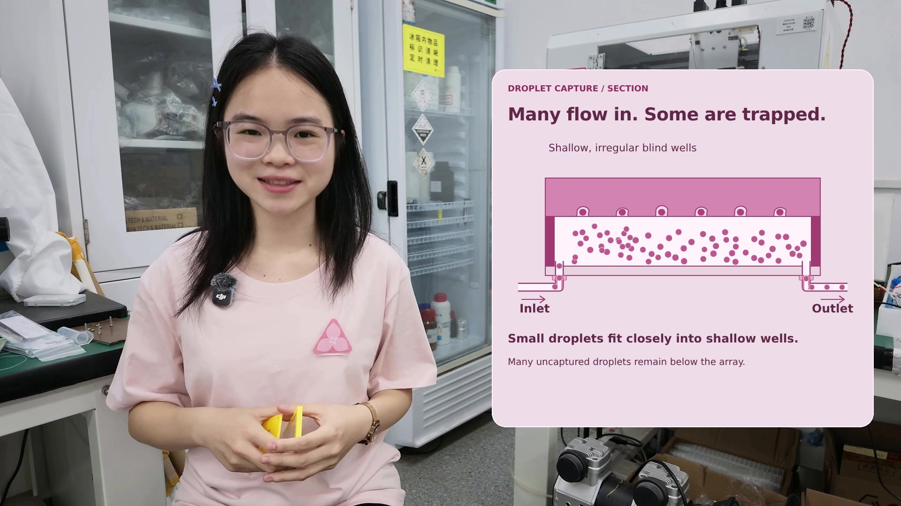

# 微流控视频修改版

[下载修改版视频 MP4](https://github.com/Wang-Ke-Yi/-/raw/refs/heads/main/video-revision/flow-cell-corrected.mp4) · [下载可编辑 HyperFrames 工程 ZIP](https://github.com/Wang-Ke-Yi/-/raw/refs/heads/main/video-revision/flow-cell-hyperframes-project.zip)

## 本次更新

制作过程按顺序展示：三层核心结构叠合，此时没有外框 → 两端圆孔下方各贴带孔的切割硅胶双面胶 → 胶垫下贴入口、出口接头 → 最后合上外框，四角用螺栓和螺母压紧。

使用演示补齐出入口与连接管道，展示大量小液滴连续从入口进入。盲孔改浅、轮廓略不规则，尺寸接近单个液滴；少量液滴被孔卡住，大量未进孔的液滴留在阵列下方，部分继续流向出口。孔形和流动为概念示意，不表示加工尺寸或测量数据。

保留前次修改：去掉独立玻璃板，以 PET 为底板；删除胶层腔体内三个圆点；两端圆孔通过通道连接矩形主腔。

## 文件

- `flow-cell-corrected.mp4`：1920×1080、30 fps、19.4 秒成片，保留原声音轨、人物镜头与背景。
- `flow-cell-hyperframes-project.zip`：可编辑工程，包含原视频素材、图解源码、字体与许可、渲染及合成脚本。解压后阅读 `README.zh-CN.md`。

右侧粉色图解由 HyperFrames 0.8.181 重绘和渲染，最终通过 FFmpeg 合成并复制原始 AAC 音轨。不新增口播字幕、配乐或配音。文件名与原文件夹保持一致。

如 GitHub 不直接播放，请点击上方下载链接后观看。
