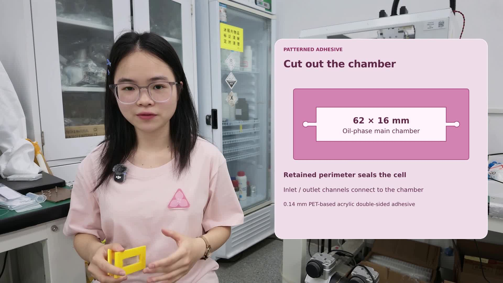

# 微流控视频修改版

[下载修改版视频 MP4](https://github.com/Wang-Ke-Yi/-/raw/refs/heads/main/video-revision/flow-cell-corrected.mp4) · [下载可编辑工程 ZIP](https://github.com/Wang-Ke-Yi/-/raw/refs/heads/main/video-revision/flow-cell-hyperframes-project.zip)

- `flow-cell-corrected.mp4`：修改后的成片，1920×1080、30 fps、19.4 秒，保留原声音轨。
- `flow-cell-hyperframes-project.zip`：可编辑 HyperFrames 工程，包含输入原视频、图解源码、字体和合成脚本。解压后阅读 `README.zh-CN.md`。

修改内容：删除独立玻璃板，三层结构使用 PET 底板；删除胶层腔体内三个圆点，补齐两端圆孔连接白色矩形主腔的通道；同步更新装配图、盲孔剖面图和相关标注。

由于输入只有 MP4，没有原 HyperFrames 工程，右侧图解按原粉色风格重绘。

若 GitHub 不直接播放 MP4，请打开对应文件后下载到本地播放。工程 ZIP 需要下载并解压。
